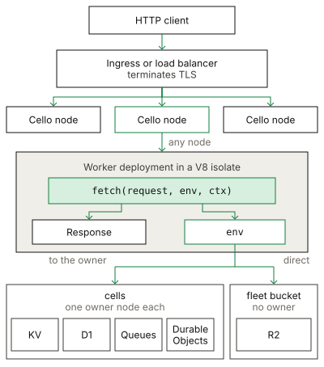

A Worker is a stateless request handler that uses the [Cloudflare Workers API](https://developers.cloudflare.com/workers/runtime-apis/). Cello runs your deployment in a V8 isolate on every node of the fleet.

## Run a minimal Worker

Save these two files, then run `cello dev .` and open the printed URL. This example runs unchanged on `cello dev` (verified with cello 0.2.1).

```jsonc
// wrangler.jsonc
{ "name": "hello", "main": "index.js", "compatibility_date": "2026-01-01" }
```

```js
// index.js
export default {
  async fetch(request, env) {
    return new Response("Hello from cells! url=" + request.url);
  },
};
```

```sh
cello dev .
curl "http://127.0.0.1:9876/?x=1"
# Hello from cells! url=http://127.0.0.1:9876/?x=1
```

The full runnable version is in [`examples/hello`](https://github.com/ryuzcorp/cello/tree/main/examples/hello).

<!-- cello-example: hello -->

## Use the supported API

- `fetch(request, env, ctx)` is the default export. It receives the inbound `Request` and returns a `Response`.
- `scheduled` handles a Cron Trigger, and `queue` handles a Queues consumer.
- `env` holds the bindings your Wrangler configuration declares.
- `ctx.waitUntil(promise)` keeps the isolate alive for the promise after the response reaches the client.

Read the [handlers documentation](https://developers.cloudflare.com/workers/runtime-apis/handlers/) for the complete list.

## Understand the request path

Cello serves plain HTTP, so an ingress proxy terminates TLS. A load balancer can send a request to any node, because every node holds the current deployment. That node runs the handler, and it forwards each binding call to the node that owns the cell. An R2 binding reads and writes the fleet bucket directly.



Each export of the main module must be a handler object or a class, as in workerd. A main module that exports a string or a number fails to start.

Cello runs many requests in one isolate and retires isolates at any time. Keep your state in a binding, not in module scope.

## Handle the differences from Cloudflare

| Area | Cello behavior |
| --- | --- |
| Domains and TLS | Cello serves plain HTTP. It manages no custom domain and terminates no TLS. |
| `ctx.passThroughOnException()` | No effect, because Cello has no CDN. |
| Workers AI | No AI binding. The process rejects `CELLO_AI_BINDING` and `CELLO_AI_URL`, and a deployment rejects an `ai` declaration. |

The [Cloudflare compatibility](../reference/cloudflare-compat.md#services) page lists the runtime APIs and the unsupported services.

## Python Workers

A Worker whose `main` is a `.py` file uses the [Cloudflare Python Workers](https://developers.cloudflare.com/workers/languages/python/) API. The same project runs on Cloudflare without a change.

The full runnable version is in [`examples/python`](https://github.com/ryuzcorp/cello/tree/main/examples/python).

<!-- cello-example: python -->

Run `uv run pywrangler sync` to vendor packages into `python_modules/`, then run `cello dev .`. The build rejects an incomplete Workers SDK (`workers-runtime-sdk`).

`cello deploy` bundles the Pyodide runtime, `python_modules/`, and the files below the directory of `main` that match the default Wrangler module rules: `.py`, `.txt`, `.html`, `.sql`, `.bin`, and `.wasm`. The Worker opens each file under `/session/metadata`, as on Cloudflare. Nothing downloads at run time.

The first build downloads the Pyodide runtime from the Pyodide CDN and checks the size and SHA-256 of each file. Later builds reuse `$XDG_CACHE_HOME/cello/pyodide-0.28.3`, or `~/.cache/cello/pyodide-0.28.3`. Set `CELLO_PYTHON_RUNTIME_DIR` to use another directory; a populated directory lets a build run offline. A download fails after 60 seconds without data. The build needs `esbuild` on `PATH`, or `CELLO_ESBUILD` set to its path.

A Python deployment requires the `python-workers-v1` feature, and `cello deploy` does not check the nodes for it. A running node without the feature logs an error and keeps its current deployment, so the fleet serves two versions. A node without the feature that starts while a Python deployment is current exits with an error. Upgrade every node before the first Python deployment, and do not downgrade while one is current.

Cello runs Pyodide 0.28.3 with CPython 3.13.2 and the `pyodide_2025_0` wheel ABI. Your configuration must satisfy:

- `compatibility_flags` includes `python_workers`.
- `compatibility_date` has the form `YYYY-MM-DD`.
- `compatibility_date` is 2026-04-21 or later. With an earlier date, a flag must turn on each behavior the date does not: `python_workers_force_new_vendor_path` before 2025-08-11, `python_no_global_handlers` before 2025-08-14, `python_workers_20250116` before 2025-09-29, and `enable_python_external_sdk` before 2026-04-21.
- `compatibility_date` is before 2026-09-08, or the flags include `no_python_workers_314`. From 2026-09-08 Cloudflare runs Pyodide 314 (Python 3.14), which needs wheels for another ABI.

Cello refuses other settings at deploy time. `python_process_pth_files` follows its compatibility date (2026-05-26).

Supported:

| API | Notes |
| --- | --- |
| `Default(WorkerEntrypoint).fetch` | One instance for each request, as on Cloudflare |
| `workers.Response`, `Response.json`, request body, text and headers | Compared with workerd in the tests |
| `workers.fetch` | Outbound HTTP |
| `self.env` bindings | Tested with KV. Other bindings are the objects a JavaScript Worker gets, untested from Python |
| `self.ctx.waitUntil` | Python awaitables stay alive until they settle |
| Pure-Python packages in `python_modules/` | Tested with `beautifulsoup4` |
| `from js import ...` | The JavaScript globals of the isolate |

Not supported:

- Durable Objects, Workflows, Cron Triggers, and Queue consumers written in Python. `cello deploy` refuses a Python project that declares them.
- Named entrypoint classes and RPC to Python methods.
- Packages with compiled extensions (`.so` files), and the standard library modules that Pyodide ships as separate packages: `ssl`, `sqlite3`, `lzma`, and the OpenSSL-backed `hashlib` algorithms.
- `pyodide.ffi.run_sync`, and `workers.import_from_javascript` for modules other than `cloudflare:workers` and `cloudflare:sockets`. Cello hides WebAssembly stack switching (JSPI), because under JSPI each async entry leaks C stack until the interpreter stops.
- `process.exit()` throws in a Python Worker.
- Memory snapshots and the import patches of the `_cloudflare` package. Package patches that need them, such as synchronous FastAPI handlers, do not apply.

The interpreter starts on the first request to an isolate, and concurrent first requests share that start. If the main module raises an error, every request to that isolate fails with the same traceback. A fatal interpreter error, such as a C stack overflow, fails every request the isolate runs. Cello then replaces the isolate, as Cloudflare does, so the next request waits for a new interpreter.

## Operate it

- `cello dev .` runs the project locally. `cello deploy . --bucket s3://NAME` ships it to the fleet.
- The Python build needs `esbuild` on `PATH` or `CELLO_ESBUILD` set to its path. Set `CELLO_PYTHON_RUNTIME_DIR` to keep the Pyodide runtime outside the cache directory.
